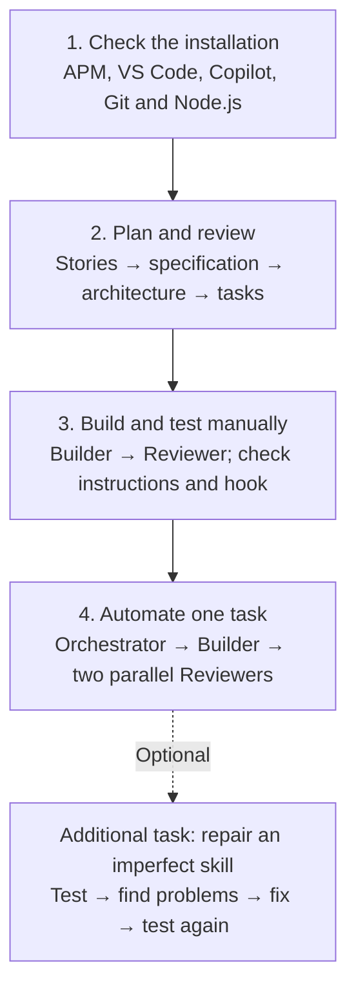

# Part 1 — Agentic SDLC Workshop



## 1. Check the installation

- Run `apm --version`; if missing, [install APM](https://github.com/microsoft/apm#installation), then run it again.
- Check `git --version`, `node --version`, your language toolchain, and a working Copilot chat in VS Code.
- Create a team project, open it in VS Code, and initialise APM:

```sh
git init sensor-fleet-health
cd sensor-fleet-health
apm init --yes --target copilot
```

Copy [stories/](./stories/) into your team project as `stories/`.

## 2. Plan and review

`Agents + Skills` · `Context Handoffs` · `Independent Review` · `Human Approval`

This task covers using agents and skills for requirements, architecture, and task planning. It also covers passing context between agents and reviewing their work before moving on.

### Install and verify

Install Planner and its skill:

```sh
apm install github.com/proanja/agentic-sdlc-primitives/agents/orchestration/spec-driven-dev/planner.agent.md
apm install github.com/proanja/agentic-sdlc-primitives/skills/functional-spec
```

Open **Chat: Open Customizations** and verify Planner and `functional-spec` are available.

**Planner is the agent; functional-spec is the procedure it follows.** The skill helps turn stories into confirmed requirements, explicit boundaries and error cases, and testable acceptance criteria with concrete examples. Missing rules become questions for you, not invented requirements.

### Write the specification

- Read [stories 01–03](./stories/) yourself first.
- Start a **Planner** chat and ask it to read the stories, use `functional-spec`, and write `specs/feature.md`.
- Answer any questions about genuinely missing or contradictory requirements.

The specification describes **what the service must do**, not how to implement it. The file gives Reviewer, Builder, and tests a shared reference; its name is a convention for this workflow.

### Review and correct the specification

Install Reviewer before reviewing the specification:

```sh
apm install github.com/proanja/agentic-sdlc-primitives/agents/orchestration/spec-driven-dev/reviewer.agent.md
```

- Start a **new Reviewer chat** and ask it to check `specs/feature.md` against the stories.
- Copy its findings back to the **original Planner chat** and ask Planner to correct the specification. Reviewer reports problems; it cannot edit files.
- If a finding needs a business decision, make that decision yourself and tell Planner.
- Review the corrected file in a fresh Reviewer chat. Repeat until blocking findings are resolved, then approve the specification yourself.

**Keep one Planner conversation; use a fresh Reviewer conversation for each review pass.** Switching agents within one chat retains the conversation context, so it is not an independent review. The files carry the work between chats; you pass file paths and review findings yourself, without an automatic handoff.

### Design and review the architecture

- Choose a backend language and framework your team knows.
- In the original Planner chat, approve the specification, state your stack, and ask for `docs/architecture.md`.

The architecture describes **how the service will be built**: components, endpoints, data model, storage, and testing approach. Agreeing on these decisions now means Builder does not have to invent them while coding.

- In a fresh **Reviewer** chat, ask it to check `docs/architecture.md` against `specs/feature.md`.
- Bring findings back to Planner, correct the document, and review again in a fresh Reviewer chat until blocking findings are resolved.
- Approve the architecture yourself before moving on.

### Generate implementation tasks

- In the original **Planner** chat, approve the architecture and ask it to create small, ordered files in `tasks/`.
- Check that each task identifies the acceptance criteria it covers, dependencies, expected tests, and a done checklist.
- The first task should be a working project skeleton with one passing test. **Planner writes the tasks; Builder implements them in Task 3.**

## 3. Build and test manually

`Code + Tests` · `Context Handoffs` · `Scoped Instructions` · `Hooks` · `Independent Review`

This task covers implementing and reviewing code and tests with agents. It also covers passing implementation results between agents and checking how instructions and hooks affect their work.

### Install and verify

Install Builder, **Testing rules (`tests.instructions.md`)**, and the **protect-stories** hook:

```sh
apm install github.com/proanja/agentic-sdlc-primitives/agents/orchestration/spec-driven-dev/builder.agent.md
apm install github.com/proanja/agentic-sdlc-primitives/instructions/testing/tests.instructions.md
apm install github.com/proanja/agentic-sdlc-primitives/hooks/protect-stories
```

- The hook currently requires **Bash and jq**; check `bash --version` and `jq --version` in the environment where Copilot runs.
- Open **Chat: Open Customizations** and verify Builder, the testing instruction, and the hook are available.

**Builder is the implementation agent.** Unlike Planner, it can write application code and run commands. It reads the approved specification, architecture, and selected task, implements one task with tests, then stops for human review.

### Implement the project skeleton

- Start a **new Builder chat**, give it the path to the first file in `tasks/`, and ask it to implement that task.
- Read terminal commands before approving them. Check that Builder actually runs the relevant tests and build, and reports the exact commands and results.
- If a command fails or tooling is missing, resolve it before treating the task as complete. A statement that tests pass is not a substitute for a test run.

### Record the project commands

- Ask Builder to identify the build, test, and run commands from the generated project configuration.
- Run those commands in the project terminal: check the build and test output, start the service, verify it responds, then stop it.
- Ask Builder to record the verified commands in a short `AGENTS.md` at the project root, under **Build**, **Test**, and **Run**. Include any required working directory or local setup.
- Keep this file up to date; it gives future agent chats the actual project commands instead of making them guess. If the stack has no separate build step, say so rather than inventing one.

### Read the handoff note

Builder writes `work/Txx-build.md` for each task, for example `work/T01-build.md` for the skeleton. The `work/` folder holds these implementation notes, not application code.

Check that the note records:

- The task ID and changed files.
- The commands actually run and their results.
- Unresolved issues and what Reviewer should inspect.

This is the **handoff**: Reviewer can read the implementation results without seeing Builder's conversation. The note is reported evidence, not proof that everything works.

### Review and correct the implementation

- Start a **fresh Reviewer chat** and provide the task path, the handoff note, and the changed files. Ask it to check them against `specs/feature.md` and `docs/architecture.md`.
- Reviewer can inspect code and tests, but cannot run commands. Check its findings alongside the test output you observed.
- Copy findings back to the **original Builder chat**. Ask Builder to fix defects, rerun the relevant tests and build, and update the handoff note.
- Review again in a fresh Reviewer chat until blocking findings are resolved, then approve the result yourself.
- Repeat this flow for **one feature task** after the skeleton. Leave the remaining tasks for Task 4.

You switch agents and pass file paths and findings manually here; no agent starts the next one automatically.

### Check the testing instruction

**Testing rules (`tests.instructions.md`)** is a file-specific instruction, not a skill you ask an agent to run. Its `applyTo` patterns select test files, such as `tests/test_health.py` or `health.test.ts`.

- When Builder edits a test file, inspect the instruction references in the chat and check that the instruction applies to that filename.
- Check the resulting tests against its rules: trace acceptance criteria, cover normal cases, invalid input and exact boundaries, and use controllable time instead of sleeps or the real clock.
- If the instruction is not applied, inspect its `applyTo` pattern against your test filenames; do not assume installation alone means it was used.

### Try the story-protection hook

The stories are the agreed input. Builder should implement their rules, not change them to make its code or tests pass. The **protect-stories** hook blocks recognized direct edits to `stories/` and `.github/hooks/`, and asks for approval of recognized terminal calls.

- As a controlled test, ask the agent to change the warning temperature in `stories/03-spot-devices-needing-attention.md` from 70 to 75 degrees Celsius.
- Check that an attempted edit tool call is **denied by the hook**. If the agent only refuses in its answer, no hook has been tested.
- Confirm the story is unchanged. If the edit succeeds, restore the original value yourself and investigate the hook registration before continuing.
- Do not approve a terminal command that changes protected files. The hook is a guardrail, not protection against every possible way of editing a file.

**Committing is optional.** A commit can give you a checkpoint before Task 4, but this task is complete when the skeleton and one feature task are tested, reviewed, and approved by you, with the instruction and hook checks performed.

## 4. Automate one task

`Automation` · `Subagents` · `Parallel Review` · `Context Handoffs` · `Human Approval`

This task covers automating the build-and-review flow for one implementation task. It also covers observing subagents, parallel work, and the points where human approval is still needed.

### Install and verify

Install Orchestrator:

```sh
apm install github.com/proanja/agentic-sdlc-primitives/agents/orchestration/spec-driven-dev/orchestrator.agent.md
```

- Open **Chat: Open Customizations** and verify Orchestrator is available, alongside Builder and Reviewer from Task 3.
- Open the installed Orchestrator definition. Its `agent` tool lets it start other agents, and `agents: ['Builder', 'Reviewer']` limits which ones it can start.

**Orchestrator is the coordinator, not another coding agent.** It has no editing or terminal tools: it delegates implementation to Builder, requests reviews, combines findings, and sends fixes back to Builder.

A **subagent** runs in a separate context. It receives the task and file paths from Orchestrator, rather than the full conversation of another worker. The files and handoff notes still carry the work; Orchestrator now passes them instead of you doing it manually.

### Start one implementation task

- Choose the next unimplemented file in `tasks/` whose dependencies are complete.
- Start a **new Orchestrator chat** and ask it to implement that task, giving the task's file path.
- Let Orchestrator coordinate the flow; do not manually switch to Builder or Reviewer in this chat.
- Continue reading commands before approving them. Automation does not mean approving every tool call.

Expect this sequence:

1. **Builder** implements the task, runs the tests and build, and writes `work/<task-id>-build.md`.
2. **Two Reviewers run in parallel**, after Builder finishes: one checks correctness, the other checks test coverage.
3. **Orchestrator combines findings** and sends blocking issues back to Builder.
4. **Builder fixes, then both Reviewers review again.** Orchestrator allows at most two fix rounds before stopping with any remaining findings.
5. **Orchestrator reports to you and stops.** It must not start the next task automatically.

### Observe the subagents and parallel reviews

- Expand the subagent or agent-tool entries in the chat. Look for one Builder call followed by two separate Reviewer calls; depending on your VS Code version, these may be grouped.
- Inspect what Orchestrator passes to each worker: the task, specification, architecture, and, for review, the Builder's handoff note. The two Reviewers should receive different review focuses.
- Look for both Reviewer calls being in progress at the same time, or overlapping execution times if shown. Two review summaries alone do not prove the reviews ran in parallel.
- Check that Orchestrator waits for both reviews before combining their findings and asking Builder for fixes.
- If the interface does not expose enough detail to confirm overlap, note that rather than claiming you observed parallel execution.

The two reviews are independent and read-only; they can inspect the same files concurrently. Builder runs before them, and any fixes happen after both reviews finish.

### Check the result yourself

- Read Orchestrator's final report: which workers ran, what they returned, the reported test command and result, and any remaining findings.
- Read `work/<task-id>-build.md` and inspect the changed code and tests. Reviewers cannot run tests, so distinguish Builder's reported results from results you observed yourself.
- Run the relevant tests and build in your terminal before approving the result.
- Check that **Testing rules (`tests.instructions.md`)** still applies when Builder runs as a subagent, and that the **protect-stories** hook remains active. Do not assume delegation bypasses or guarantees either check.
- If a worker is missing or fails, or blocking findings remain after the fix limit, resolve the problem before moving on. Orchestrator should report the problem, not silently do the worker's job.

**Committing is optional.** Approve the result yourself before requesting another task.

### Compare with the manual flow

- Which file paths and findings did you pass yourself in Task 3 that Orchestrator now passes?
- What could you observe or interrupt more easily in the manual flow?
- Did the correctness and test reviews identify different problems?
- Which decisions and checks still needed you?

## Additional task — Repair an imperfect skill

`Skills` · `Discovery` · `Testing Primitives`

This task covers testing and improving a skill, including whether agents discover it and whether its instructions produce correct results.

### Test the original

- Copy the [imperfect skill example](./examples/SKILL.md.example) into your team project as `.agents/skills/version-comparison/SKILL.md`.
- In a new chat, request firmware comparison without naming the skill; then explicitly request the installed skill and check whether it is used.
- Test `2.9.3` vs `2.10.0`, `1.10.0` vs `2.0.0`, and `3.0.0-rc.2` vs `3.0.0` against story 03.
- Record what failed and how you observed it; check discovery and correctness separately.

### Fix and retest

- Read the skill and fix the problems you found.
- Repeat the same prompts and comparisons in a new chat. Check both whether the agent uses the skill without being told and whether the results match the story.
- Check that an unrelated device-registration request does not load the skill.

### Decide what belongs in a shared repo

- Decide whether to keep the fix local, contribute a reusable skill to the public primitives repo, or separate reusable guidance from project-specific rules.
- Give one sentence explaining your choice. Contribute only the corrected, reusable primitive, not the exercise material.
